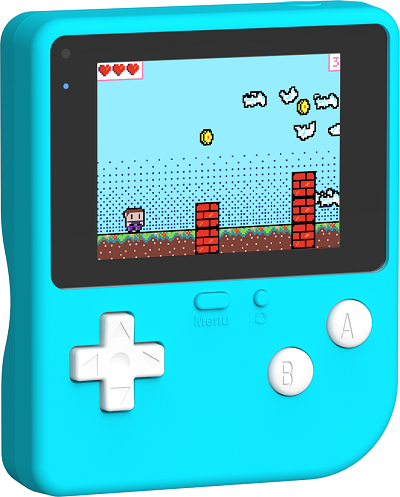
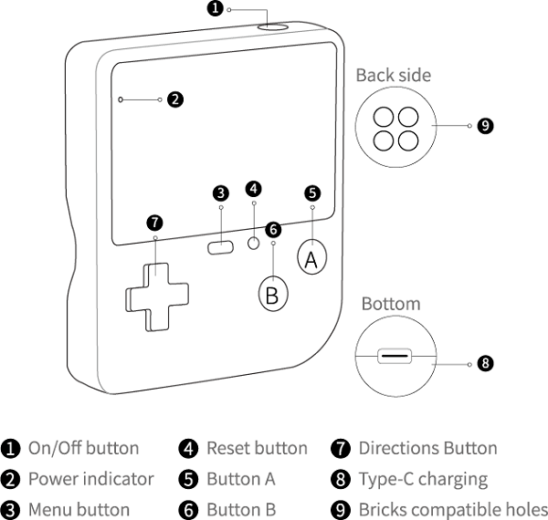
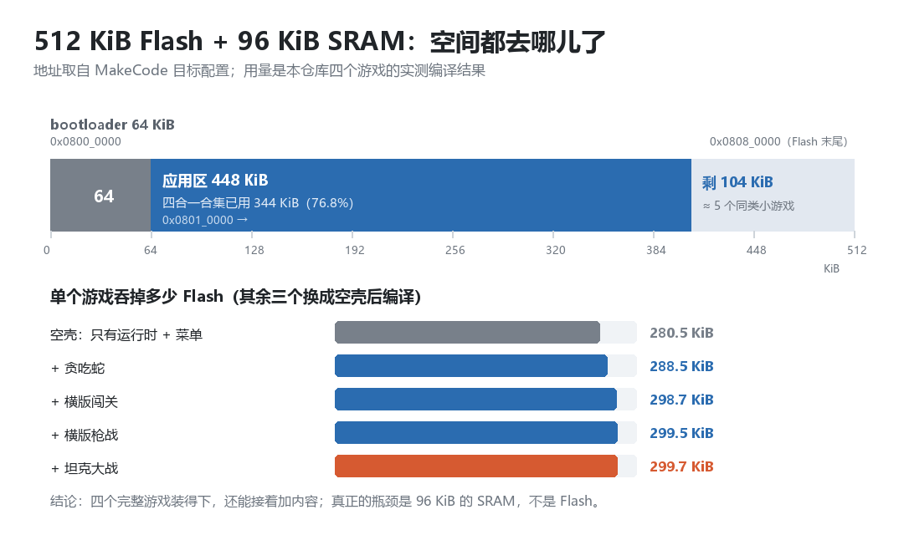
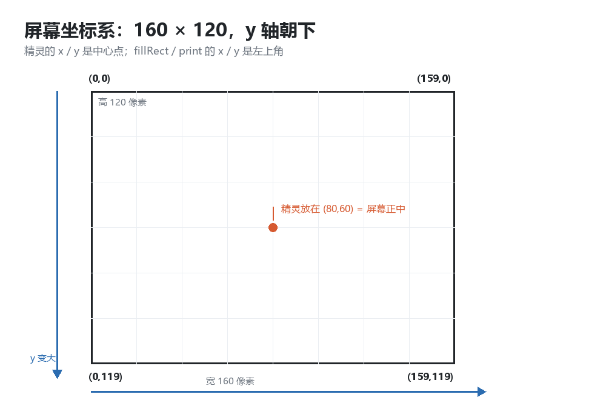
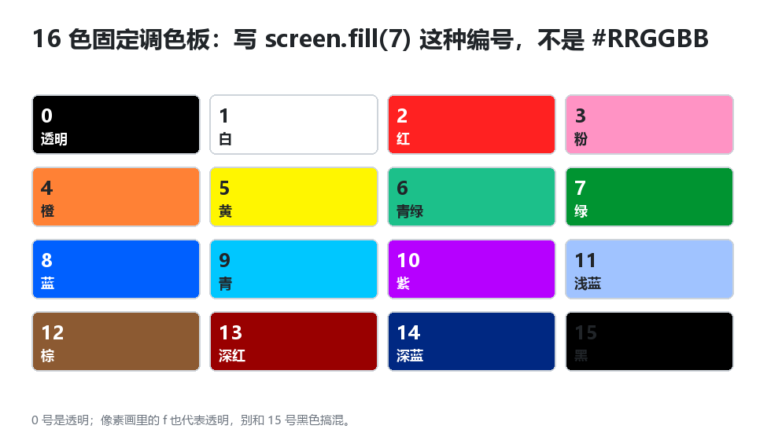
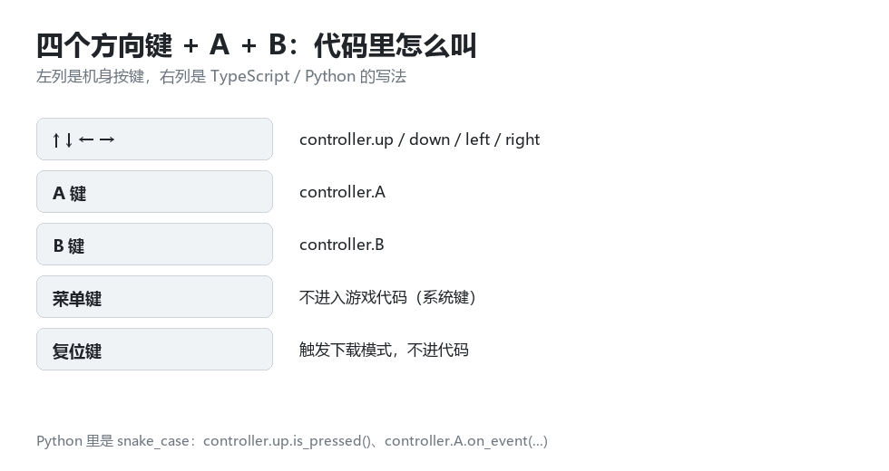
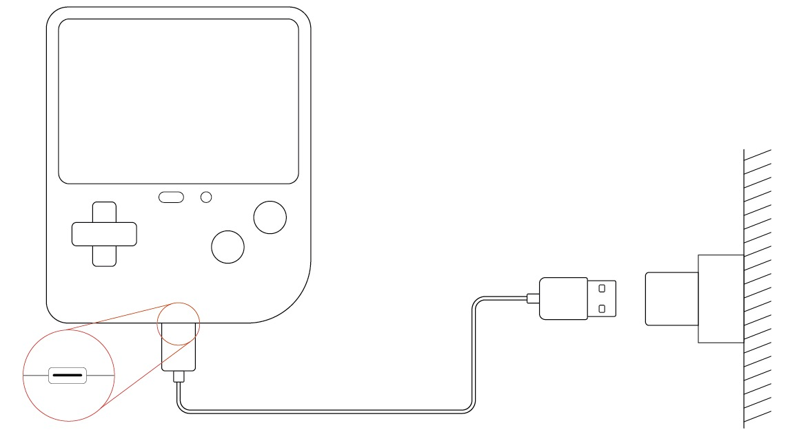

# 硬件介绍：饼干游戏编程学习机（ELECFREAKS Retro Arcade）

> 这一篇只讲**硬件本身**：长什么样、按键怎么叫、内存有多大、屏幕怎么算坐标、什么能跑什么跑不了。
> 想直接动手写代码，从 [`01-认识这台机器与开发环境.md`](01-认识这台机器与开发环境.md) 开始。
> 官方资料：<https://wiki.elecfreaks.com/retroarcade/product-introduction/>



---

## 1. 它是什么

一台**掌上游戏编程学习机**：青色塑料外壳 + 硅胶按键，专门按孩子手掌大小做的。屏幕 2.4 英寸、320×240 彩色，机身里塞了蜂鸣器、光敏传感器、陀螺仪、震动马达，背面有乐高兼容孔，可以拼在积木上。

它的定位不是"游戏机"，而是"**自己写游戏、顺便看懂游戏背后发生了什么**"的教学硬件：

- 编程环境是微软 **MakeCode Arcade**（积木 / JavaScript / Python 三视图随时切换，自带模拟器）
- 程序编译成 `.uf2` 文件，插 USB、按复位键、拖进去就完事，**不需要装驱动、不需要烧录器**
- 主控是 **STM32F401**（Cortex-M4F），在 MakeCode 里对应硬件型号 **F4**

---

## 2. 机身按键与接口




| 编号 | 名称 | 说明 | 写代码时 |
| --- | --- | --- | --- |
| ① | 开/关键 | **单击开机，双击关机** | 不进代码 |
| ② | 电源指示灯 | 工作中常亮；低电量闪烁 | 不进代码 |
| ③ | 菜单键 | 系统键 | 不进代码 |
| ④ | **复位键** | 按一下进入**下载模式**，变成 U 盘 | 不进代码（但刷机全靠它） |
| ⑤ | **A 键** | 右边大圆键 | `controller.A` |
| ⑥ | **B 键** | 右边小圆键 | `controller.B` |
| ⑦ | 方向键 | 十字键 ↑↓←→ | `controller.up / down / left / right` |
| ⑧ | Type-C 口 | 充电 + 传数据（**必须是数据线**） | — |
| ⑨ | 兼容积木孔 | 背面 4 个，可拼乐高 | — |

---

## 3. 官方规格，以及"写代码时意味着什么"

| 项目 | 官方数值 | 写代码时要知道的 |
| --- | --- | --- |
| 主控 | STM32F401（Cortex-M4F，典型 84 MHz） | MakeCode 里选 **F4**；`mkc.json` 写 `"hwVariant": "stm32f401"` |
| 屏幕 | 2.4 英寸，**320×240** | ⚠️ MakeCode 的**逻辑分辨率只有 160×120**，引擎内部 2 倍放大。坐标按 160×120 算 |
| 颜色 | 彩色屏 | ⚠️ 游戏里只能用 **16 色固定调色板**，编号 0~15，不是 `#RRGGBB` |
| Flash | 512 KiB | 扣掉 bootloader 64 KiB，**应用区约 448 KiB** |
| SRAM | 96 KiB | 精灵、数组、子弹都在这；用完必须 `destroy()`，否则越来越卡 |
| 存储 | **无 SD 卡、无外部 Flash、无文件系统** | 「加载好多 ROM」做不到；只能 `settings` 存几个数字 |
| 输入 | 方向键 + A + B + 菜单 + 复位 | 没有键盘、没有触摸、没有 Start/Select |
| 传感器 | 蜂鸣器、光敏、陀螺仪、震动马达 | `music.*` 发声；其余靠扩展积木读取 |
| 通信 | 只有 USB（UF2 刷机 + WebUSB） | **没有 Wi-Fi、蓝牙**，做不了联网 |
| 供电 | 560 mAh 锂电池，3.7 V，Type-C 5 V / 1.35 A | 充满约 1.5 小时 |
| 扩展 | 背面乐高兼容孔 | 只能"物理"扩展，**没有引出 GPIO 排针** |

### 内存地图：东西都堆在哪儿



两个数字记住就够：

- **应用区 448 KiB**：本仓库最"重"的四合一游戏合集用了 **344 KiB**，还剩 104 KiB；
- **SRAM 96 KiB**：这才是真正的瓶颈 —— 精灵太多、数组无限 `push`，先炸的是内存，不是 Flash。

### 为什么"一次只能刷一个游戏"

UF2 烧录是**整个应用区整体覆盖**，不是往文件系统里拷文件。拖第二个 `.uf2` 进去，第一个就没了。
但"**一个程序里装很多游戏**"完全可以 —— 见 [`projects/04-game-collection`](../projects/04-game-collection/README.md)：开机菜单选一个，把选择写进 Flash 再 `game.reset()` 软重启，重启后只启动选中那个分支。

---

## 4. 屏幕与坐标



- 逻辑坐标范围 **x: 0~159，y: 0~119**，左上角是 `(0,0)`
- 和数学坐标系**相反**：往下 y 变大 → 「向上飞」的速度写**负数**
- 精灵的 `x / y` 是**中心点**；`screen.fillRect(x,y,w,h,c)` 的 `x / y` 是**左上角**

### 16 色固定调色板



`15` 是黑、`1` 是白、`2` 是红；`0` 号是透明，像素画里的 `f` 也代表透明 —— 不要和 15 号黑色搞混。

```ts
screen.fill(15)                    // 全屏刷黑
screen.printCenter("HI", 60, 5)    // y=60 位置、黄色居中
screen.fillRect(10, 10, 20, 8, 7)  // 左上角 (10,10)、20×8 的绿色方块
```

---

## 5. 按键在代码里叫什么



```ts
controller.A.onEvent(ControllerButtonEvent.Pressed, function () { /* A 按下 */ })
if (controller.left.isPressed()) { /* 左键按住 */ }
```

```python
def on_a():
    pass

controller.A.on_event(ControllerButtonEvent.PRESSED, on_a)

if controller.left.is_pressed():
    pass
```

> 菜单键、复位键、开关键都是**系统键**，游戏代码里拿不到，别指望用它做"暂停"。

---

## 6. 供电、充电与指示灯



| 状态 | 指示灯 |
| --- | --- |
| 工作中 / 电量充足 | 常亮 |
| 低电量 | 闪烁 |
| 充电中 | 闪烁（充电完成转常亮） |

- 充电器 5 V / 1 A 以上，约 1.5 小时充满
- **必须用能传数据的 Type-C 线**：很多"纯充电线"没有数据线芯，插上电脑后设备根本不会出现，刷机自然没反应 —— 这是最常见的"刷不进去"原因

---

## 7. USB、驱动与下载模式

插上电脑后，设备在系统里是 `USB\VID_0483&PID_5799`（STM32 的厂商号）：

| 接口 | Windows 识别成 | 用途 |
| --- | --- | --- |
| 接口 0 | `WinUsb Device`（系统自带） | 网页版「设备配对 / 一键下载」走它 |
| 接口 1 | `Arcade (app)`，可能带感叹号（错误码 28） | 设备自定义接口，**刷机用不到** |

- **不装任何驱动也能刷机**：按一下复位键 → 屏幕进入下载界面 → 电脑多出一个 `ARCADE-F4` U 盘 → 把 `.uf2` 拖进去 → 机器自动重启开跑
- 那个感叹号想消掉，双击 [`tools/install-driver.cmd`](../tools/install-driver.cmd)，UAC 点「是」（只绑定系统自带 WinUSB）

---

## 8. 能跑什么、跑不了什么

一句话：**它是一台 84 MHz / 96 KiB 内存 / 160×120 逻辑分辨率的嵌入式小电脑，适合"一屏一个交互"的小程序。**

**非常适合（几十行就能做）**

- 计算器、单位换算、口算练习、乘法表
- 秒表、倒计时、番茄钟、回合计时、计分板
- 电子骰子、抽签/随机点名、猜数字、剪刀石头布
- 手电筒、摩斯电码练习器、电子琴、节拍器
- 反应速度测试、记忆力（Simon Says）、电子宠物、像素绘图板
- 各类街机小游戏：贪吃蛇、打砖块、飞机大战、平台跳跃、坦克大战

**能用但要靠传感器**

- 水平仪 / 倾角仪、摇一摇计数器（陀螺仪）
- 照度计、光线寻宝（光敏）
- 震动提醒、震动猜谜（震动马达）

**做起来别扭**

- **中文界面**：默认点阵字库只有 ASCII，中文要自绘点阵或用图标（所以本仓库界面都用英文）
- **断电保存**：只能 `settings` 存少量数字，没有文件系统
- **闹钟**：没有 RTC 实时时钟，断电后时间不准，只能做"开机后计时"

**做不了**

- 网页、联网、在线更新、视频 / MP3、拍照
- 大容量存档、文件管理、数据库
- 中文输入法、长文本阅读
- 多任务操作系统、真正的"应用商店"

---

## 9. 顺带回答：能写 GB / NES 模拟器吗？

**不能，尤其是"加载好多游戏"这种。** 逐条卡点：

| 瓶颈 | 具体情况 |
| --- | --- |
| **内存（最致命）** | GB 一帧 160×144 的 16 位色缓冲就要 46 KiB，8 位色也要 23 KiB；再加 VRAM / WRAM / OAM 约 20 KiB。这台机器总共 96 KiB SRAM，运行时自己还要占帧缓冲、精灵池、GC 堆 |
| **存储（决定"好多游戏"没戏）** | 没有 SD 卡、没有外部 Flash，`ARCADE-F4` 盘是 bootloader 虚拟的伪盘。ROM 集合没地方放 |
| **显示与输入** | 逻辑 160×120 要塞 160×144，得裁剪或缩放；没有 Start / Select 键 |
| **音频** | 只有一个蜂鸣器，模拟 4 声道 APU 不现实 |
| **开发方式** | MakeCode 的静态 TS / Python 没有指针和高效字节数组，写 CPU 解释器不现实；真要写得完全裸机 C++，等于放弃积木、模拟器和全部教程 |

NES/FC（6502 + PPU + 更大的 ROM）只会更难。

> 想给孩子讲"模拟器"这个概念，可行的替代是：自己定义 4~8 条指令、用数组当内存，做一个**极简自制虚拟机**跑一个自己写的小游戏；或者直接用多游戏合集讲"一个程序里装多个游戏"。

---

## 10. 相关资料

| 内容 | 链接 |
| --- | --- |
| 官方产品简介（本文规格来源） | <https://wiki.elecfreaks.com/retroarcade/product-introduction/> |
| 官方程序下载方式 | <https://wiki.elecfreaks.com/retroarcade/program-download-method> |
| MakeCode Arcade 网页版 | <https://arcade.makecode.com> |
| 本文示意图生成脚本 | [`tools/gen-doc-images.py`](../tools/gen-doc-images.py) |

> 图片说明：`01-product.png`、`02-buttons-en.png`、`03-buttons-cn.png`、`04-charging.png` 来自 ELECFREAKS 官方 wiki（仅作教学引用）；`05`~`08` 是本仓库用脚本生成的原图。
